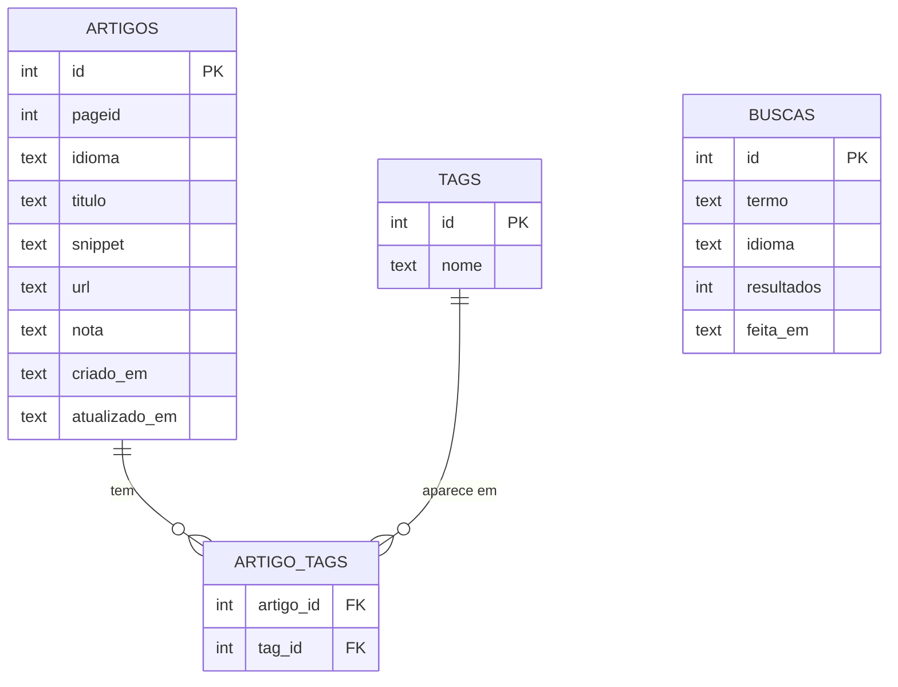

# WikiCRUD

Um pequeno app de terminal para quem pesquisa na Wikipedia e não quer perder o fio da meada.

Você busca um assunto, escolhe o artigo que interessa e **guarda** com uma nota sua e algumas tags. Depois é só voltar, filtrar, corrigir uma anotação ou apagar o que não serve mais. É um CRUD (Create, Read, Update, Delete), mas com um propósito concreto: ser o seu caderninho de pesquisa.

Não precisa instalar nada além do Python 3.8 ou mais novo.

## Para rodar

```bash
python wikicrud.py                # Wikipedia em português
python wikicrud.py --idioma en    # Wikipedia em inglês
python wikicrud.py --db teste.db  # usa outro arquivo de banco
```

Na primeira vez, o app cria o banco sozinho. Você vai ver um menu assim:

```
 1) Buscar na Wikipedia e salvar   (Create)
 2) Listar / filtrar salvos        (Read)
 3) Ver detalhes de um artigo      (Read)
 4) Editar nota/tags               (Update)
 5) Excluir artigo                 (Delete)
 6) Histórico de buscas
 0) Sair
```

Alguns detalhes que ajudam no dia a dia:

- Ao editar, apertar **Enter** mantém o valor que já estava lá. Digitar **`-`** apaga o campo.
- O filtro da opção 2 procura no título, na nota e nas tags ao mesmo tempo.
- Tags são normalizadas: `Python, WEB, python` vira `python, web`.
- Antes de excluir, o app sempre pergunta. Qualquer resposta diferente de `s` cancela.

---

Este README responde a três perguntas que todo projeto deveria responder antes de ganhar corpo. Vamos a elas.

## 1. Onde o app vai guardar os dados?

**Num banco de dados SQLite**, dentro de um arquivo chamado `wikicrud.db` que aparece ao lado do código na primeira execução.

Escolhi o SQLite porque ele é um banco de verdade (tabelas, relacionamentos, transações, restrições) mas não pede servidor, senha nem instalação. O Python já vem com ele. Para um app pessoal, é o ponto ideal: você copia a pasta para outro computador e tudo vai junto.

### Como o banco está organizado

São quatro tabelas, definidas em SQL no começo do `wikicrud.py` (constante `SCHEMA`):



Em português claro:

- **`artigos`** guarda o que você decidiu salvar: título, link, um trecho, sua nota e as datas de criação e de última alteração.
- **`tags`** guarda cada tag uma única vez. Se dez artigos são "python", existe uma linha só para "python".
- **`artigo_tags`** faz a ponte entre as duas. Um artigo pode ter várias tags, e uma tag pode estar em vários artigos.
- **`buscas`** é o diário das suas pesquisas, para você lembrar o que já procurou.

### Decisões que valem ser explicadas

**Por que as tags têm tabela própria, em vez de um campo de texto?** Foi assim na primeira versão, e não funcionava bem: bastava escrever "Python" num artigo e "python" em outro para virarem coisas diferentes, e filtrar era uma gambiarra. Com a tabela separada o banco garante a organização por você.

**Como o banco evita bagunça?** Três regras ficam no próprio banco, não no código:

- Um mesmo artigo (mesmo `pageid` no mesmo idioma) não pode ser salvo duas vezes.
- Se você apaga um artigo, as ligações dele com as tags somem junto (`ON DELETE CASCADE`). E o app ainda remove as tags que ficaram sem uso.
- Salvar um artigo com suas tags é uma **transação**: ou grava tudo, ou não grava nada. Nunca sobra um pedaço.

**O que *não* é guardado?** O texto completo dos artigos. A Wikipedia continua sendo a fonte da verdade; o app guarda só o suficiente para você reconhecer o artigo e voltar a ele pelo link.

### Limites (para ser honesto)

- O arquivo é local: não há sincronização entre máquinas nem vários usuários ao mesmo tempo. Se um dia isso for necessário, o caminho natural é migrar para PostgreSQL. Como todo o acesso ao banco está isolado numa seção própria do `wikicrud.py`, a mudança ficaria concentrada ali.
- O filtro usa `LIKE`, que ignora maiúsculas só para letras sem acento. Buscar "PITON" não acha "Píton".

---

## 2. Como o app toma decisões de fluxo?

Pense no app como um atendente paciente: ele mostra o cardápio, espera você escolher, faz o que foi pedido e volta a perguntar. Só para quando você manda parar.

Na prática é um **laço com menu**. Cada número do menu aponta para uma função, e depois de cada ação o app volta ao menu. Tecnicamente, o menu é um dicionário `{"1": (rótulo, função), ...}`, então adicionar uma opção nova é adicionar uma linha.

As decisões acontecem em três momentos:

1. **Antes de agir, o app confere se a entrada faz sentido.** Um ID com letras, uma busca vazia ou um número fora da lista resultam em um aviso curto e volta ao menu.
2. **Antes de mexer no banco, ele confere o estado das coisas.** O ID existe? A Wikipedia devolveu resultados? Esse artigo já estava salvo? Cada resposta leva a um caminho e a uma mensagem diferentes.
3. **Antes de algo irreversível, ele confirma com você.** A exclusão pergunta `(s/N)`, com o "não" como padrão, porque é o lado mais seguro para errar.

Uma regra que guiou tudo: **o app não deve quebrar na sua cara.** Se a internet cair no meio de uma busca, você recebe uma mensagem explicando e volta ao menu, com seus dados intactos. Ctrl+C também encerra sem despejar erro na tela.

Para manter cada decisão no lugar certo, o `wikicrud.py` é dividido em três seções com responsabilidades bem separadas:

| Seção do arquivo | Responsabilidade |
|---|---|
| 1. Banco de dados | O esquema das tabelas e o CRUD em SQL. Não tem `print` nem `input`. |
| 2. Rede | Conversa com a API da Wikipedia. |
| 3. Interface | Menu, perguntas e mensagens. É aqui que o fluxo é decidido. |

---

## 3. Como expressar o fluxo do app?

Para um app deste tamanho, o jeito mais claro de expressar o fluxo é **contar o caminho em passos numerados**, com as bifurcações escritas logo abaixo de cada passo. Assim dá para ler de cima para baixo, como uma receita, e qualquer pessoa entende sem precisar de ferramenta nenhuma.

Quando o app crescer (mais telas, vários usuários), vale complementar com um diagrama de sequência ou de estados. Por enquanto, texto basta.

### A visão geral

1. O app abre o banco e cria as tabelas, se ainda não existirem.
2. Mostra o menu e espera você escolher uma opção.
3. Conforme a opção:
   - **1** leva a buscar e salvar;
   - **2** lista ou filtra os artigos salvos;
   - **3** mostra os detalhes de um artigo;
   - **4** edita nota e tags;
   - **5** exclui um artigo;
   - **6** mostra o histórico de buscas;
   - **0** encerra o app;
   - qualquer outra coisa gera um aviso de opção inválida.
4. Terminada a ação, volta ao passo 2. O app só sai quando você escolhe `0`.

### O caminho mais rico: buscar e salvar

1. Pede o termo de busca.
   - Se estiver vazio, avisa e volta ao menu.
2. Consulta a API da Wikipedia.
   - Se der erro de rede, mostra a mensagem e volta ao menu.
3. Registra a busca no histórico.
4. Confere se veio algum resultado.
   - Se não veio nada, avisa e volta ao menu.
5. Lista os resultados e pede o número do que você quer salvar.
   - Se você apertar Enter, cancela e volta ao menu.
   - Se o número não estiver na lista, avisa e volta ao menu.
6. Pergunta a nota e as tags (ambas opcionais).
7. Grava o artigo e as tags juntos, numa única transação.
   - Se o artigo já estava salvo, avisa e não grava nada.
   - Se não estava, confirma com o ID novo.
8. Volta ao menu.

### O mais delicado: excluir

1. Pede o ID do artigo.
   - Se não for um número, avisa e volta ao menu.
2. Procura o artigo no banco.
   - Se o ID não existir, avisa e volta ao menu.
3. Pergunta se você quer mesmo excluir, mostrando o título.
   - Só a resposta `s` continua. Qualquer outra coisa cancela.
4. Apaga o artigo, as ligações com tags e as tags que ficaram sem uso.
5. Confirma e volta ao menu.

### Um padrão que se repete

Repare que quase todos os fluxos têm a mesma cara: **pedir → validar → conferir o estado → agir → avisar → voltar ao menu**. Todo caminho de erro termina no menu, nunca numa tela quebrada. Isso é o que dá a sensação de app confiável, e também facilita acrescentar novas opções: basta seguir o mesmo padrão.

---

## Estrutura do projeto

```
.
├── wikicrud.py    # o app inteiro: banco, busca na Wikipedia e interface
├── wikicrud.db    # seu banco (criado na primeira execução)
└── README.md      # você está aqui
```

## Se algo der errado

**"Este arquivo de banco está no formato antigo."** Você rodou uma versão anterior do app, que guardava tudo numa tabela só. Apague ou renomeie o `wikicrud.db` antigo (ou use `--db novo.db`) e rode de novo.

**"Não foi possível consultar a Wikipedia."** O app não conseguiu acessar a internet ou a API. Seus dados salvos continuam intactos e as opções 2 a 6 funcionam normalmente offline.

## O que ainda não faz

Ideias para as próximas versões: exportar os artigos para Markdown ou CSV, abrir o link direto no navegador, ordenar a listagem por data ou título, e ter uma interface web ou gráfica por cima da mesma camada de banco.
